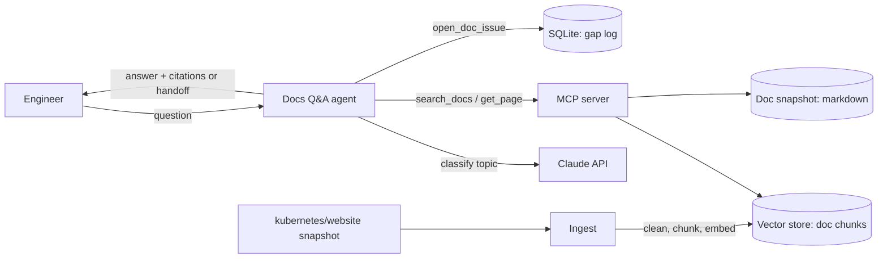

# SPEC: Kubernetes Docs Q&A Agent

| | |
|---|---|
| **Status** | v0 (draft) - Week 0. Grows weekly; see [Changelog](#changelog) |
| **Author** | Prakash Narayanasamy |
| **Capstone option** | B. Docs Q&A Agent ("talk to my docs") |
| **Last updated** | 2026-10-19 |

> Structure follows [Design Docs at Google](https://www.industrialempathy.com/posts/design-docs-at-google/)
> (context, goals and non-goals, design, alternatives, cross-cutting concerns), mapped onto the
> course's 8 spec sections. This is a "mini design doc": short, focused on trade-offs, updated as
> the design meets reality. Sections marked *TBD (Week N)* are decided in that week, not guessed now.

---

## 1. Context and scope

Kubernetes has a large public documentation set (kubernetes.io, sourced from the
`kubernetes/website` repository) split into Concepts, Tasks, Tutorials and Reference.
Engineers who support Kubernetes platforms answer the same kinds of questions repeatedly
("How does a Pod get restarted?", "How do I drain a node?") and spend time finding the right
page, then quoting or paraphrasing it.

This project builds an agent that answers Kubernetes questions **only from the official docs**,
**cites the pages it used**, and **hands off** when the docs do not cover the question, instead of
guessing.

## 2. Problem

- **Who:** support and platform engineers answering Kubernetes questions from customers and colleagues.
- **Cost today:** time spent searching and cross-reading pages; inconsistent answers; answers that
  drift from the documented behaviour; general-purpose chatbots that answer confidently without
  sources, including when the docs say nothing.

## 3. Users

A support or platform engineer asks a question in plain English from a CLI (later via an agent
interface) and gets back an answer with links to the doc pages it is based on. The engineer
checks the cited pages before reusing the answer. When the agent hands off, the engineer gets a
short note explaining what it searched and why it could not answer.

## 4. Goals and non-goals

### Goals

- Answer Kubernetes questions grounded in the official English docs.
- Cite at least one source page (and chunk) for every answer.
- Hand off clearly when the docs do not cover the question, rather than inventing an answer.
- Classify each question by topic: `concepts`, `tasks`, or `reference`.
- Be measured: one command runs the eval set and reports the success metrics (section 7).

### Non-goals

Things that could reasonably be goals but are deliberately out of scope:

- **Acting on clusters.** No `kubectl`, no API calls to a real cluster; the agent only reads docs.
- **Answering beyond the docs.** No general Kubernetes knowledge from the model's training data;
  if the docs don't say it, the agent hands off.
- **Multiple doc versions or languages.** One pinned snapshot, English only.
- **Filing real upstream issues.** `open_doc_issue` records a gap locally (SQLite); it never
  creates issues on GitHub.
- **Fine-tuning a model.** Retrieval plus prompting only.
- **A web UI.** CLI first; a UI is not needed to meet any gate.
- **Real customer data.** Only public docs and hand-written questions.

## 5. Inputs and outputs

**In:** a question as plain text.

**Out** (JSON, validated with Pydantic from Week 3):

```json
{
  "topic": "concepts | tasks | reference",
  "status": "answered | handoff",
  "answer": "string or null",
  "citations": [{"page": "docs/concepts/workloads/pods/pod-lifecycle", "chunk_id": "..."}],
  "handoff_reason": "string or null"
}
```

Exact field names may change in Week 3; the shape (topic, answered-or-handoff, citations) is the
contract.

## 6. Data

| | |
|---|---|
| **Knowledge base** | `kubernetes/website`, `content/en/docs/` - [github.com/kubernetes/website](https://github.com/kubernetes/website) |
| **Licence** | CC BY 4.0 (attribution required: credited in the README and in citations) |
| **Snapshot** | Pinned to one commit SHA so results are reproducible. *TBD (Week 2): record the SHA.* |
| **Scope** | Start with `concepts/` and `tasks/`. Generated API reference pages are excluded at first (very long, table-heavy) and revisited in Week 4. |
| **Questions** | 30 hand-written questions, each with gold page(s) and expected status. About 1 in 4 should be **out of scope** (not answerable from the docs) so handoff is actually tested. |
| **Split** | 20 labelled questions for retrieval tuning (Week 4); the 30-case eval set (Week 6) is the scoreboard and is not used to tune prompts. |

Gold labels allow **more than one correct page**, because several pages often cover the same topic.

## 7. Success metrics

The five numbers measured every week from Week 3, with **provisional** targets. Real targets are
set in Week 6 once a baseline exists.

| Metric | Definition | Provisional target |
|---|---|---|
| Answer accuracy | Answer judged correct **and** cites a gold page | >= 70% (Week 3 gate), raise after baseline |
| Retrieval recall@5 | A gold page is in the top 5 retrieved chunks | >= 0.70 (Week 4 gate) |
| Cost per question | Model spend per question, from token counts | TBD (Week 3) |
| Latency p50 / p95 | End-to-end time per question | TBD (Week 3) |
| Handoff rate | Share of questions handed off; checked against out-of-scope labels | Close to the share of out-of-scope questions in the eval set |

Handoff correctness matters in both directions: handing off an answerable question is a miss,
and answering an out-of-scope question is a worse miss (it is a confident wrong answer).

## 8. The design (overview)



1. **Ingest** (Weeks 1-2): read the pinned markdown, strip front matter and Hugo shortcodes,
   keep the page path as the stable id.
2. **Classify** (Week 3): the model labels the question `concepts | tasks | reference` as JSON.
3. **Retrieve** (Week 4): embed chunks into Chroma; retrieve top-k with chunk ids for citations.
4. **Tools** (Week 5): MCP server with `search_docs`, `get_page`, `open_doc_issue`.
5. **Agent loop and evals** (Week 6): LangGraph graph with memory; one-command eval.
6. **Architecture choice** (Week 7): single agent vs supervisor over router, retriever and
   answer-checker; kept only if the evals justify it.
7. **Hardening and observability** (Weeks 8-9): rate-limited batch question queue, retries,
   trace per question, latency and cost alarms.
8. **Security** (Week 10): prompt injection planted in a doc page; audit log of every lookup.

**Handoff rule (first version):** hand off when retrieval returns nothing above a relevance
threshold, or when the answer-check finds claims not supported by a retrieved chunk.
*TBD (Week 4-6): threshold chosen from data, not guessed.*

## 9. Alternatives considered

Initial view; each is revisited when the relevant week produces numbers.

| Alternative | Why not (for now) |
|---|---|
| **Long context: put the docs in the prompt** | The doc set is far larger than a context window, and cost per question would be high. Citations would also be harder to tie to exact chunks. |
| **Keyword search only (BM25)** | Cheap and strong on exact terms like `PodDisruptionBudget`, but weak on paraphrased questions. Kept as a **baseline** to compare against embeddings in Week 4; hybrid search is a candidate. |
| **Fine-tune a model on the docs** | Expensive, goes stale with every docs release, and does not produce citations. Non-goal. |
| **Use kubernetes.io site search** | No control over ranking, no chunk-level citations, and not measurable offline. |
| **Answer from model knowledge, docs as a bonus** | Breaks the core promise (grounded, cited, hands off when uncovered). |

## 10. Cross-cutting concerns

- **Security:** doc content is untrusted input to the model; Week 10 plants an injection in a doc
  page and measures it. Tools are read-only except `open_doc_issue`, which writes only to a local
  SQLite file. API key with a spend limit; no keys or secrets committed (`.env` in `.gitignore`).
- **Privacy:** public docs and hand-written questions only; no customer data, ever.
- **Licensing:** CC BY 4.0 attribution in the README; every answer cites its source pages.
- **Observability:** from Week 9, one trace per question covering model calls, tool calls,
  tokens, cost and latency; alarms on p95 latency and cost.
- **Cost:** USD 10-25 course budget; cost per question tracked from Week 3.

## 11. Risks and unknowns

| Risk | How to find out early |
|---|---|
| Markdown noise (front matter, shortcodes, code blocks) hurts chunk quality | Week 1-2: print 20 cleaned pages and inspect by eye |
| Several pages answer the same question, so "gold page" is ambiguous | Allow multiple gold pages; review 10 labels by hand in Week 4 |
| Judging answer correctness is subjective | Write a short rubric before Week 6; spot-check any LLM judge against hand grades |
| Handoff threshold too strict (misses answers) or too loose (guesses) | Out-of-scope questions in the eval set measure both directions |
| Docs change between snapshots | Pin one commit SHA; never re-ingest silently |
| Model spend overruns | Log tokens from the first API call (Week 3); small eval set; spend limit on the key |

## 12. Phases

Target dates assume one course week per calendar week starting 2026-10-12.

| Phase | Weeks | Target end | Exit criteria |
|---|---|---|---|
| 1. Foundations | 0-2 | 2026-11-01 | Week 2 gate: `docker run` ingests the doc snapshot; 10 tests green; 1 PR merged |
| 2. Model core | 3-4 | 2026-11-15 | Topic classifier valid JSON; recall@5 >= 0.70 on 20 questions; answers cite chunk ids |
| 3. Agent | 5-6 | 2026-11-29 | MCP tools work in Inspector; 8/10 scripted tasks; 30-case baseline recorded |
| 4. Architecture choice | 7 | 2026-12-06 | Single vs supervisor compared on the same evals; decision record written |
| 5. Production hardening | 8-9 | 2026-12-20 | Batch queue survives failures; trace per question; alarms fire in a test |
| 6. Secure and ship | 10 | 2026-12-27 | Injection red team passed; audit log; final report vs baseline |

## 13. Open questions

- Which commit SHA to pin, and whether to include `tutorials/`?
- Chunk by heading section or by fixed size? (Week 4 experiment decides.)
- Who reviews the 30 gold labels besides me?

## Changelog

- **v0 (2026-10-19):** first draft - context, goals, non-goals, data, provisional metrics, phases.
