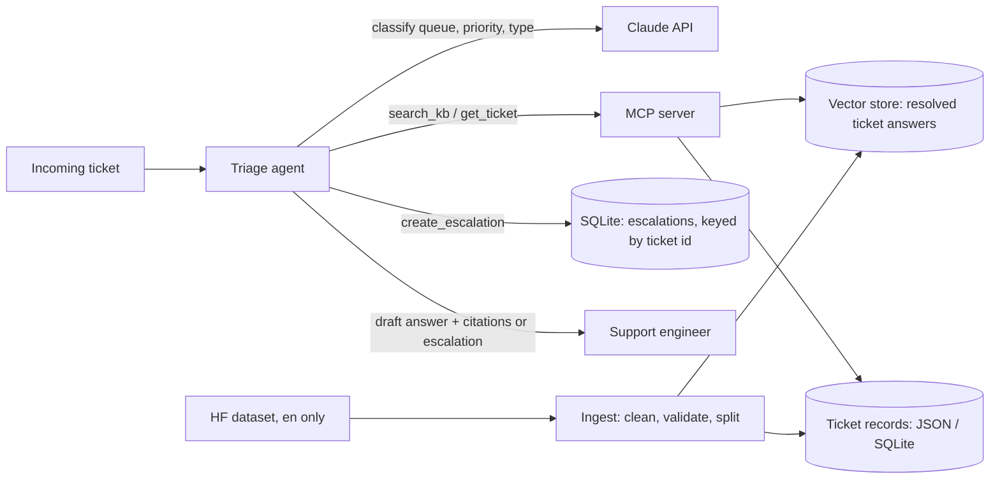

# SPEC: Ticket Triage Agent

| | |
|---|---|
| **Status** | v1 (draft) - switched from Option B to Option A; grows weekly, see [Changelog](#changelog) |
| **Author** | Prakash Narayanasamy |
| **Capstone option** | A. Ticket Triage Agent (recommended default) |
| **Last updated** | 2026-11-03 |

> Structure follows [Design Docs at Google](https://www.industrialempathy.com/posts/design-docs-at-google/)
> (context, goals and non-goals, design, alternatives, cross-cutting concerns), mapped onto the
> course's 8 spec sections. This is a "mini design doc": short, focused on trade-offs, updated as
> the design meets reality. Sections marked *TBD (Week N)* are decided in that week, not guessed now.

---

## 1. Context and scope

Support teams receive a steady stream of tickets that must be routed to the right queue, given a
priority, and either answered or escalated. Much of this is repetitive: many new tickets resemble
tickets that were already resolved, and the answer already exists in that history.

This project builds an agent that **reads a support ticket, classifies its queue, priority and
type, retrieves similar resolved tickets, and either drafts an answer with citations or escalates
to a human**. It uses only a public, synthetic ticket dataset.

## 2. Problem

- **Who:** support engineers who triage and route incoming tickets.
- **Cost today:** time spent reading and routing each ticket; misroutes bounce between teams and
  delay the first useful answer; known answers are re-written from scratch because similar past
  tickets are hard to find.

## 3. Users

A support engineer works a queue of incoming tickets. For each ticket the agent shows a suggested
queue, priority and type, plus either a draft answer that cites the resolved tickets it drew on,
or an escalation with a short reason. The engineer accepts, edits or overrides the suggestion.
**The agent never replies to a customer directly.**

## 4. Goals and non-goals

### Goals

- Classify each ticket's **queue, priority and type** as validated JSON.
- Retrieve **similar resolved tickets** and use their answers as the knowledge base.
- Either draft an answer **with citations** (ticket ids) or **escalate** to a human with a reason.
- Expose the capabilities as MCP tools: `search_kb`, `get_ticket`, `create_escalation`.
- Never escalate the same ticket twice (idempotent escalation).
- Be measured: one command runs the eval set and reports the success metrics (section 7).

### Non-goals

Things that could reasonably be goals but are deliberately out of scope:

- **Auto-replying to customers.** Every answer is a draft for a human.
- **Real customer data.** Synthetic public data only, even though the use case mirrors real work.
- **Integrating a real ticketing system** (Salesforce, Jira, Zendesk). `create_escalation` writes
  to a local SQLite table.
- **Languages other than English.** The dataset is filtered to `language = en`.
- **Fine-tuning a model.** Prompting, retrieval and tools only.
- **A web UI.** CLI first; a UI is not needed to meet any gate.

## 5. Inputs and outputs

**In:** a ticket (subject and body as text, plus a ticket id).

**Out** (JSON, validated with Pydantic from Week 3):

```json
{
  "ticket_id": "string",
  "queue": "string (one of the dataset's queue labels)",
  "priority": "string (one of the dataset's priority labels)",
  "type": "string (one of the dataset's type labels)",
  "action": "answer | escalate",
  "answer": "string or null",
  "citations": ["ticket ids of the resolved tickets used"],
  "escalation_reason": "string or null"
}
```

Allowed label values come from the dataset, not from free text. Exact field names may change in
Week 3; the shape (labels, answer-or-escalate, citations) is the contract.

## 6. Data

| | |
|---|---|
| **Dataset** | [Tobi-Bueck/customer-support-tickets](https://huggingface.co/datasets/Tobi-Bueck/customer-support-tickets) on Hugging Face (synthetic) |
| **Licence** | CC BY-NC 4.0: attribution required, non-commercial use only (this is a learning project) |
| **Filter** | English only (`language = en`) |
| **Fields used** | subject, body, answer, queue, priority, type. *Week 3: confirm field names and label values against the dataset card and record them here.* |
| **Snapshot** | Pin the dataset revision so results are reproducible. *TBD: record the revision.* |

**Split** (decided now because it prevents leakage later):

| Set | Size | Used for |
|---|---|---|
| Ingest sample | 100 tickets | Week 2 ingest and tests |
| Classifier eval | 50 labelled tickets | Week 3 gate |
| Held-out eval | 30 labelled tickets | Week 6 baseline and every later comparison; never used to tune prompts |
| Knowledge base | Resolved tickets **not** in either eval set | Week 4 retrieval |

Eval tickets are excluded from the knowledge base, otherwise retrieval would find the ticket
itself and its own answer, and the metrics would look far better than reality.

## 7. Success metrics

The five numbers measured every week from Week 3. Targets are **provisional** and are reset in
Week 6 once a baseline exists.

| Metric | Definition | Provisional target |
|---|---|---|
| Queue accuracy | Predicted queue matches the dataset label | >= 70% (Week 3 gate), >= 80% final |
| Cost per ticket | Model spend per ticket, from token counts | <= USD 0.01 |
| Latency p95 | End-to-end time per ticket | <= 8 s |
| Escalation rate | Share of tickets routed to a human | 10-25% |
| Duplicate actions | Escalations created twice for the same ticket | 0 |

Supporting metrics: valid-JSON rate (50/50 at Week 3), retrieval recall@5 on 20 tickets
(>= 0.70 at Week 4, where a hit means a hand-checked relevant resolved ticket is in the top 5),
and priority and type accuracy reported alongside queue accuracy.

Escalation is judged in both directions: escalating an easy ticket wastes a human's time, but
answering a ticket the knowledge base doesn't cover produces a confident wrong answer, which is worse.

## 8. The design (overview)



1. **Ingest** (Weeks 1-2): load English tickets into dataclasses, clean text, split into the sets
   above, save as JSON; runs as a CLI in Docker with tests.
2. **Classify** (Week 3): the model returns queue, priority and type as validated JSON; two tools
   (`get_ticket`, `lookup_history`) added to the classifier.
3. **Retrieve** (Week 4): embed resolved ticket answers into Chroma; return the top-k similar
   tickets with ids for citations.
4. **Tools** (Week 5): MCP server with `search_kb`, `get_ticket`, `create_escalation`.
5. **Agent loop and evals** (Week 6): LangGraph graph with memory; 30-ticket eval in one command.
6. **Architecture choice** (Week 7): single agent vs supervisor over classifier, retriever and
   escalation agents; kept only if the evals justify it.
7. **Hardening and observability** (Weeks 8-9): queue of incoming tickets, retries with backoff,
   idempotent escalation; trace per ticket, p95 and cost-per-ticket alarms.
8. **Security** (Week 10): prompt injection via the ticket body; audit log of every escalation.

**Escalation rule (first version):** escalate when classification confidence is low, when no
retrieved ticket is similar enough, or when the draft answer contains claims not supported by
the cited tickets. *TBD (Weeks 4-6): thresholds chosen from data, not guessed.*

**Idempotency:** `create_escalation` uses the ticket id as its key, so retrying the same call
returns the existing escalation instead of creating a second one.

## 9. Alternatives considered

Initial view; each is revisited when the relevant week produces numbers.

| Alternative | Why not (for now) |
|---|---|
| **Keyword rules for routing** | Cheap and transparent, but brittle with paraphrased tickets. Useful as a sanity baseline. |
| **Classic ML classifier (TF-IDF + logistic regression)** | Fast, cheap, and possibly strong on queue labels. Worth running once as a **baseline** in Week 3: if it matches the LLM's accuracy, that's an important finding. It can't draft answers, though. |
| **Single LLM call, no retrieval** | Simpler, but answers come from model knowledge rather than resolved tickets, with no citations. |
| **Fine-tune a model on the tickets** | Costly, goes stale as tickets change, and is a non-goal for this course. |
| **Fully automatic replies** | Removes the human check that keeps wrong answers away from customers. Non-goal. |

## 10. Cross-cutting concerns

- **Security:** ticket text is untrusted input; Week 10 tests prompt injection via the ticket body.
  Tools are read-only except `create_escalation`, which writes only to a local SQLite table.
  API key with a spend limit; no keys or secrets committed (`.env` in `.gitignore`).
- **Privacy:** synthetic public data only; no real customer data, ever. Treat ticket text as if it
  could contain personal data anyway, so logs never print full ticket bodies.
- **Licensing:** CC BY-NC 4.0, non-commercial learning use, with attribution in the README.
- **Observability:** from Week 9, one trace per ticket covering model calls, tool calls, tokens,
  cost and latency; alarms on p95 latency and cost per ticket.
- **Cost:** USD 10-25 course budget; cost per ticket tracked from Week 3.

## 11. Risks and unknowns

| Risk | How to find out early |
|---|---|
| Synthetic labels are noisy or inconsistent | Week 3: check 20 labels by hand before trusting accuracy numbers |
| Queues are imbalanced, so accuracy hides poor results on small queues | Report per-queue counts (Week 2) and per-queue accuracy (Week 3) |
| The `language` field is wrong for some tickets | Spot-check 20 filtered tickets in Week 2 |
| Eval tickets leak into the knowledge base | Split before indexing; a test asserts no eval id is in the KB |
| Resolved answers in the dataset are themselves wrong | Escalate on weak support; spot-check cited answers in Week 4 |
| Escalation threshold too strict or too loose | Escalation rate measured against hand labels in the eval set |
| Model spend overruns | Log tokens from the first API call; spend limit on the key |

## 12. Phases

Target dates assume one course week per calendar week starting 2026-10-12. Adjust to your
actual progress.

| Phase | Weeks | Target end | Exit criteria |
|---|---|---|---|
| 1. Foundations | 0-2 | 2026-11-01 | `docker run` ingests 100 tickets; 10 tests green in the container; image builds from a clean clone |
| 2. Model core | 3-4 | 2026-11-15 | 50/50 valid JSON, queue accuracy >= 70%, cost and latency recorded; recall@5 >= 0.70 with cited ticket ids |
| 3. Agent | 5-6 | 2026-11-29 | MCP tools work in Inspector; 8/10 scripted tasks; 30-ticket baseline recorded |
| 4. Architecture choice | 7 | 2026-12-06 | Single vs supervisor compared on the same evals; decision record written |
| 5. Production hardening | 8-9 | 2026-12-20 | 50-user load test < 1% errors, 0 duplicate escalations; trace per ticket; alarms fire in a test |
| 6. Secure and ship | 10 | 2026-12-27 | <= 1 of 20+ injections succeeds; escalations audited; final report vs baseline |

## 13. Open questions

- Which dataset revision to pin?
- How many distinct queue labels are there in the English subset, and are any too small to evaluate?
- Should priority errors count less than queue errors (e.g. one level off)?
- Who reviews the 30 eval labels besides me?

## Changelog

- **v1 (2026-11-03):** switched capstone from Option B (Docs Q&A) to Option A (Ticket Triage);
  rewrote scope, data, metrics, design and risks for tickets.
- **v0 (2026-10-19):** first draft for Option B.
